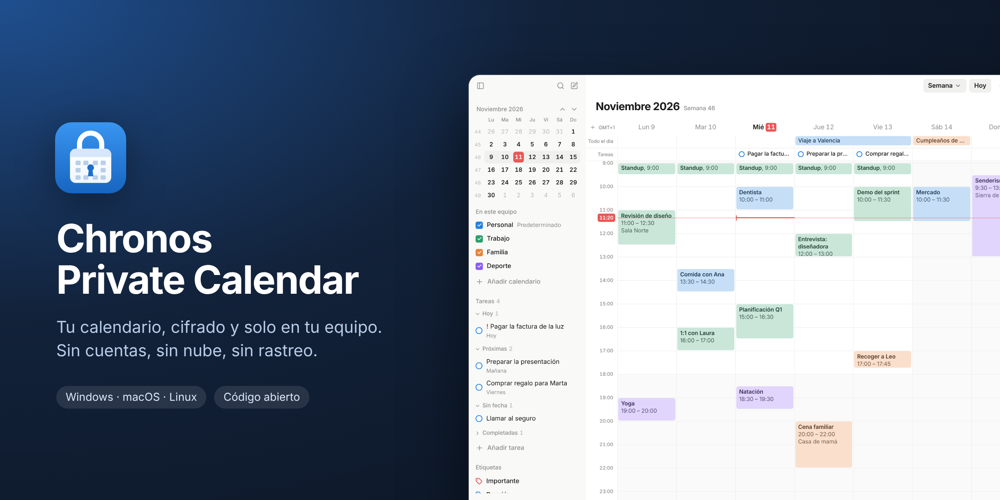
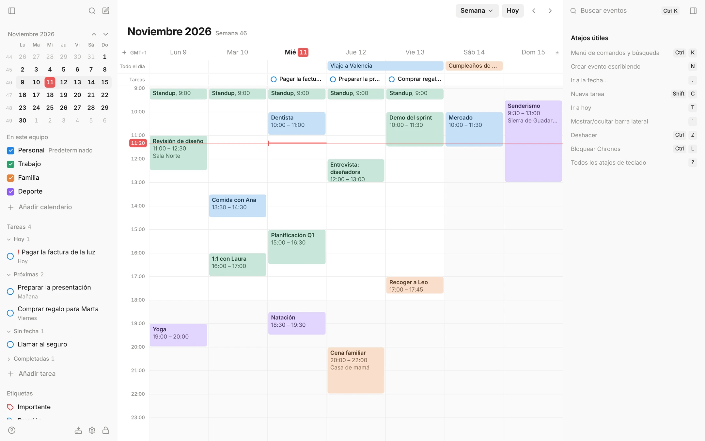
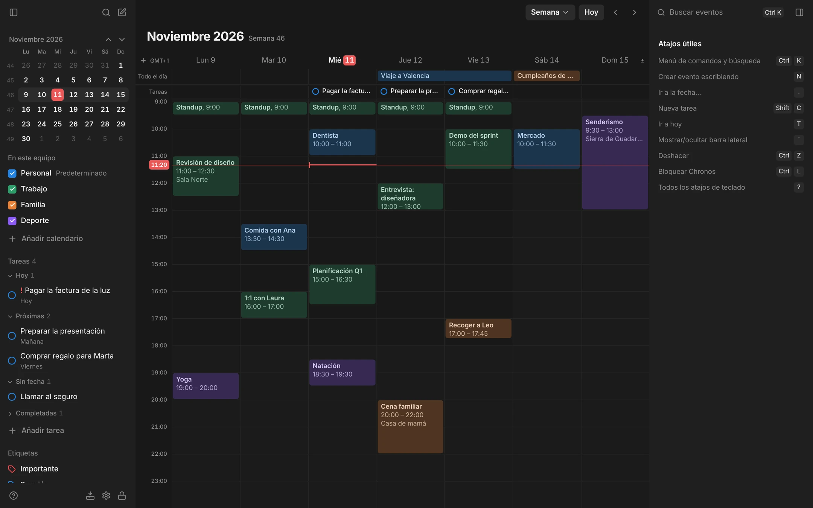
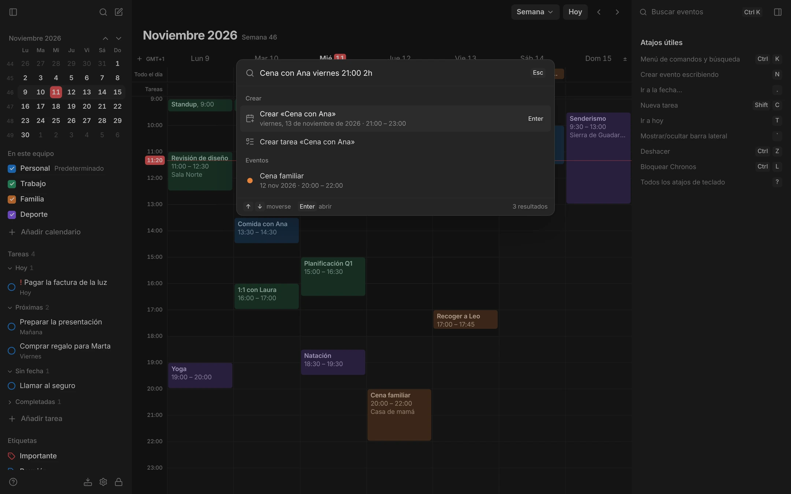
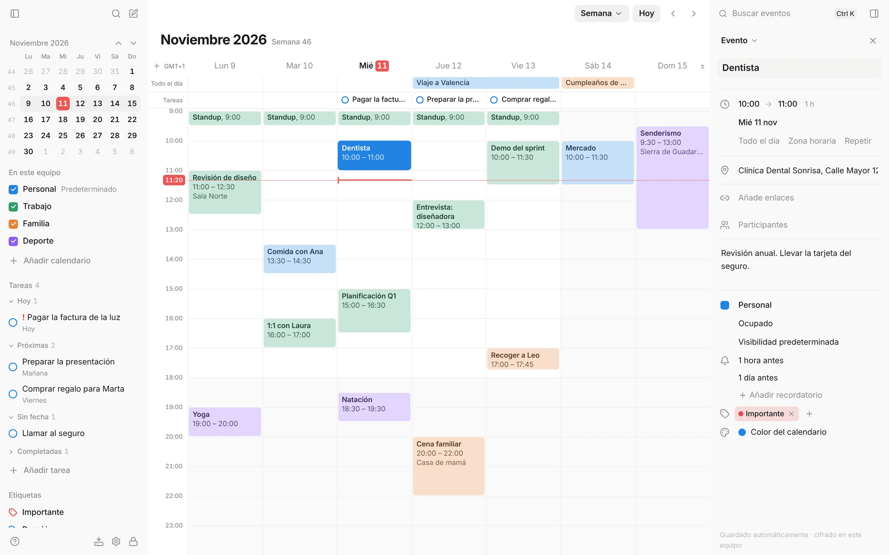
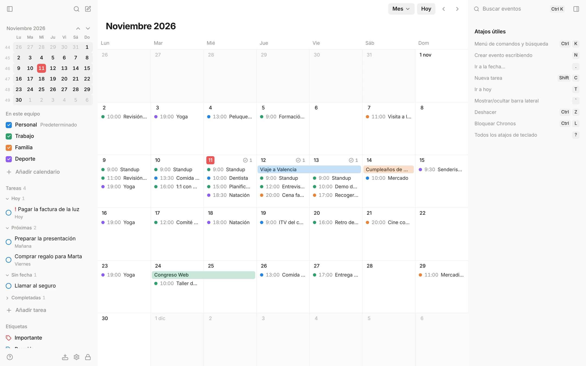
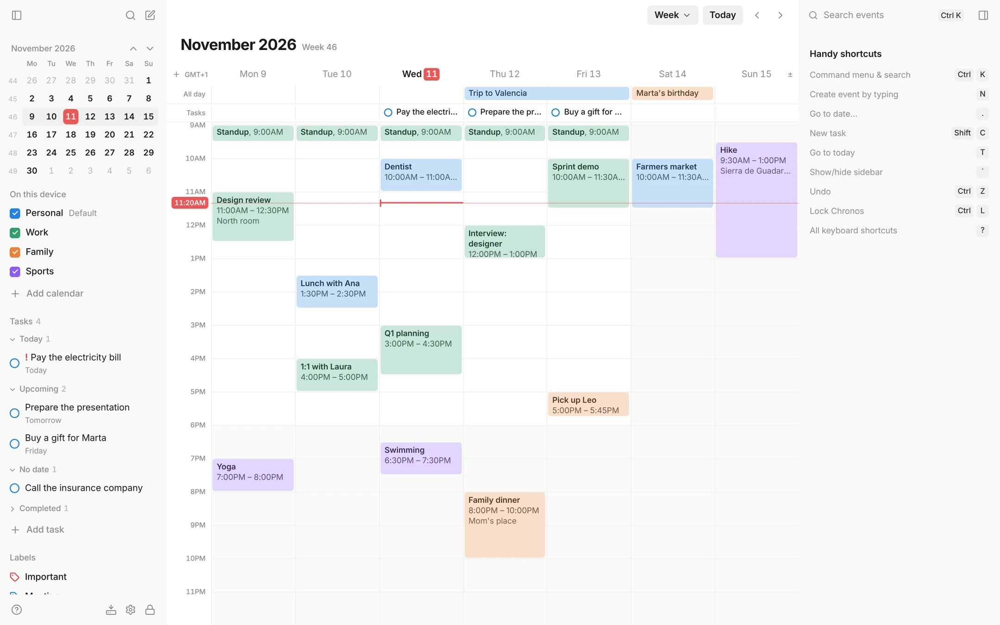
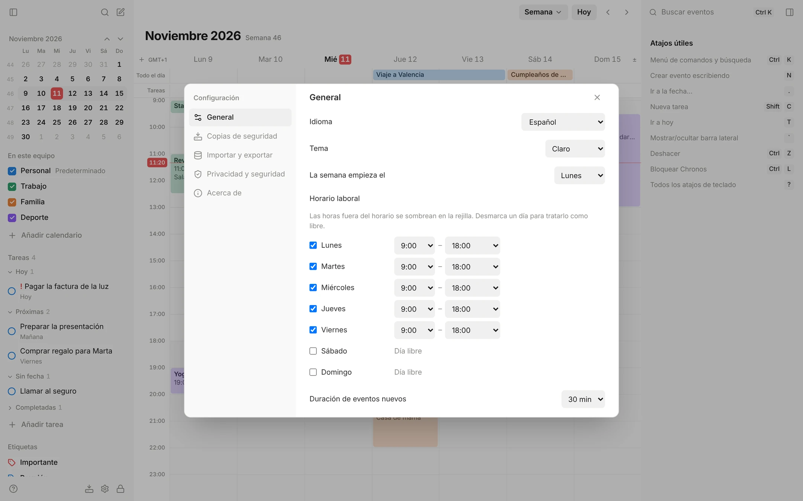
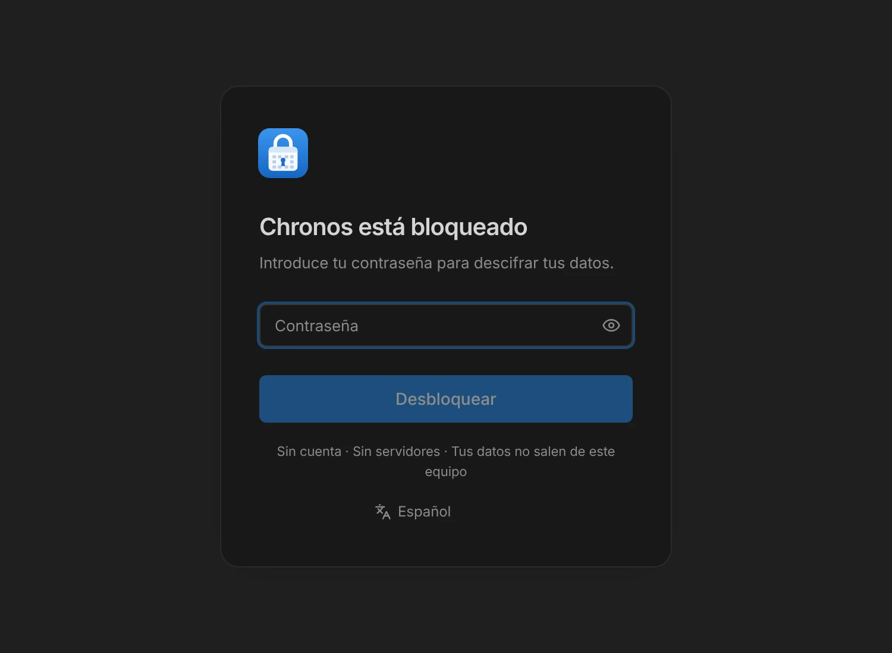

<p align="center">
  
</p>

<p align="center">
  <a href="https://github.com/RobertoNovelo12/Chronos-Private-Calendar/releases/latest"></a>
  <a href="https://github.com/RobertoNovelo12/Chronos-Private-Calendar/actions/workflows/ci.yml"></a>
  <a href="LICENSE"></a>
  
</p>

# Chronos Private Calendar

Un calendario de escritorio **local, privado y cifrado**. Tus eventos, tareas y recordatorios viven solo en tu equipo, en una base de datos cifrada con tu contraseña. Sin cuentas, sin servidores y sin telemetría.

**[⬇️ Descargar la última versión](https://github.com/RobertoNovelo12/Chronos-Private-Calendar/releases/latest)** · [Guía de uso](docs/USER_GUIDE.md) · [Seguridad](docs/SECURITY.md) · [Novedades y plan](docs/ROADMAP.md)

## Por qué Chronos

* 🔒 **Cifrado de verdad.** Toda la base de datos va cifrada con SQLCipher; la clave sale de tu contraseña (Argon2id) y nunca se guarda en claro.
* 🏠 **Tus datos no salen de tu equipo.** No hay cuenta ni nube. La única conexión de red es buscar actualizaciones, y solo cuando tú lo pides.
* ⚡ **Rápido y cómodo.** Crea eventos escribiendo («Dentista mañana 5pm 1h»), usa el menú de comandos (`Ctrl+K`) y maneja todo con el teclado.
* 💾 **Copias de seguridad cifradas** automáticas, e importación y exportación en `.ics` para llevar tus datos a cualquier otro calendario.
* 🌍 **9 idiomas**: español, English, 简体中文, Português (Brasil), Français, Deutsch, 日本語, 한국어 y Русский.

## Capturas

<table>
  <tr>
    <td width="50%"><br><sub><b>Semana</b>: eventos, tareas del día y calendarios de colores.</sub></td>
    <td width="50%"><br><sub><b>Tema oscuro</b>, o el del sistema.</sub></td>
  </tr>
  <tr>
    <td><br><sub><b>Crear escribiendo</b> desde el menú de comandos (<code>Ctrl+K</code>).</sub></td>
    <td><br><sub><b>Detalles</b> con recordatorios, etiquetas y participantes; se guardan solos.</sub></td>
  </tr>
  <tr>
    <td><br><sub><b>Mes</b>, Día, Agenda o el número de días que quieras.</sub></td>
    <td><br><sub><b>En tu idioma</b>, con fechas y formatos locales.</sub></td>
  </tr>
  <tr>
    <td><br><sub><b>Configuración</b>: idioma, tema, horario laboral por día, bandeja del sistema…</sub></td>
    <td><br><sub><b>Desbloqueo</b> con tu contraseña; nadie más puede leer tus datos.</sub></td>
  </tr>
</table>

## Instalar

1. Descarga el instalador de tu sistema en **[Releases](https://github.com/RobertoNovelo12/Chronos-Private-Calendar/releases/latest)**: Windows (`-setup.exe` o `.msi`), macOS (`.dmg`) o Linux (`.AppImage`, `.deb` o `.rpm`).
2. Ábrelo y crea tu contraseña. **Guárdala bien**: si la olvidas, no hay forma de recuperar los datos (salvo desde una copia cuya contraseña recuerdes).
3. Las siguientes versiones se instalan desde la propia app: **Configuración → Acerca de → Buscar actualizaciones**.

Los instaladores no llevan firma de código, así que Windows y macOS mostrarán un aviso la primera vez (en Windows: «Más información → Ejecutar de todas formas»). Las actualizaciones desde la app sí van firmadas y se verifican antes de instalarse.

## Funciones

<details>
<summary><b>Calendario</b></summary>

* Vistas **Día, Semana, Mes, Agenda y número de días a elegir** (2–21), mini calendario con números de semana, indicador de hora actual, formato 12/24 h
* **Eventos**: crear con clic o arrastrando, mover, redimensionar, día completo y de varios días, eventos simultáneos lado a lado, aviso de conflictos
* **Eventos que se repiten** (cada día, semana, día laborable, mes, año o personalizado) con edición de «este», «este y los siguientes» o «todos»
* **Recordatorios** con notificaciones del sistema (con opción de ocultar el título)
* Panel de detalles con guardado automático: fechas, calendario, color, ubicación, disponibilidad, privacidad, enlaces, notas, **etiquetas** y **participantes** (nota local; Chronos no envía invitaciones)
* **Tareas** con fecha opcional, prioridad, notas y recordatorios, en la barra lateral y en el calendario
* Segunda zona horaria en la rejilla, zona horaria por evento y **horario laboral por día** de la semana
* Varios calendarios con color: mostrar/ocultar, reordenar, predeterminado
</details>

<details>
<summary><b>Rapidez y teclado</b></summary>

* **Menú de comandos** (`Ctrl+K` o `/`): busca eventos (sin distinguir acentos), ejecuta acciones, salta a fechas y crea eventos o tareas
* **Crear eventos escribiendo** (`N`), en español o inglés: «Dentista mañana 5pm 1h», «Gimnasio lunes y miércoles 7am», «Viaje 10–12 dic»
* **Ir a la fecha** (`.`): «15 dic», «próximo lunes», «en 2 semanas»
* **Navegación con teclado**: flechas entre eventos, `Enter` abre, `Alt+flechas` mueve 15 min o un día; foco visible y etiquetas para lectores de pantalla
* Copiar, pegar y duplicar eventos; **deshacer/rehacer** (`Ctrl+Z` / `Ctrl+Shift+Z`), también en series
* Todos los atajos con `?`
</details>

<details>
<summary><b>Privacidad y seguridad</b></summary>

* Base de datos SQLite **cifrada con SQLCipher**; clave derivada con Argon2id y envuelta con XChaCha20-Poly1305
* Bloqueo manual (`Ctrl+L`), desde la bandeja o automático por inactividad
* **Opcional**: recordar el desbloqueo en este equipo (Administrador de credenciales de Windows / Llavero de macOS)
* Sin red salvo **actualizaciones bajo petición**, descargadas de los *Releases* oficiales y **verificadas con la firma del autor**
* CSP estricta, fuentes empaquetadas, sin telemetría ni informes de errores
* Cambio de contraseña y **«Eliminar todos mis datos»**
* Detalles y limitaciones honestas en [docs/SECURITY.md](docs/SECURITY.md)
</details>

<details>
<summary><b>Copias, importar y exportar</b></summary>

* Copias cifradas `.chronosbak`: **automáticas** (diarias o semanales, con retención y carpeta elegible), manuales, antes de restaurar y antes de actualizar; verificar y restaurar desde la app
* **Importar** `.ics` (Google, Outlook, Apple…) y `.json` sin duplicados
* **Exportar** ICS, JSON, CSV o copia cifrada, por calendario, por fechas o un solo evento
</details>

<details>
<summary><b>Escritorio</b></summary>

* **Bandeja del sistema**: cerrar la ventana la oculta y la app sigue avisando
* **Iniciar con el equipo**, opcionalmente minimizado; una sola instancia
* Tema claro, oscuro o del sistema; **9 idiomas** (también en notificaciones e instalador)
</details>

## Documentación

| Documento | Contenido |
|---|---|
| [docs/USER_GUIDE.md](docs/USER_GUIDE.md) | **Guía de uso** para quien usa la aplicación |
| [docs/ARCHITECTURE.md](docs/ARCHITECTURE.md) | Arquitectura, carpetas, dependencias, flujo de la app |
| [docs/DATA_MODEL.md](docs/DATA_MODEL.md) | Esquema SQLite, recurrencias, zonas horarias |
| [docs/SECURITY.md](docs/SECURITY.md) | Privacidad, cifrado, modelo de amenazas y **limitaciones** |
| [docs/BACKUP_FORMAT.md](docs/BACKUP_FORMAT.md) | Formato `.chronosbak` y restauración |
| [docs/ROADMAP.md](docs/ROADMAP.md) | Plan por fases y novedades de cada versión |

## Desarrollo

### Preparar el equipo (Windows)

Hace falta una sola vez:

1. **Visual Studio Build Tools 2022** con la carga de trabajo *Desarrollo para el escritorio con C++* (incluye el SDK de Windows):
   ```powershell
   winget install Microsoft.VisualStudio.2022.BuildTools --override "--wait --passive --add Microsoft.VisualStudio.Workload.VCTools --includeRecommended"
   ```
2. **Rust** (toolchain MSVC):
   ```powershell
   winget install Rustlang.Rustup
   ```
3. **Strawberry Perl** — necesario para compilar OpenSSL, que SQLCipher usa como proveedor criptográfico (el Perl que trae Git para Windows no sirve):
   ```powershell
   winget install StrawberryPerl.StrawberryPerl
   ```
4. **NASM** (recomendado, acelera OpenSSL): `winget install NASM.NASM`
5. **Node.js** 20 o superior (ya instalado si `node --version` funciona). WebView2 viene con Windows 10/11.
6. Cierra y vuelve a abrir la terminal para que se actualice el `PATH`.

Si PowerShell muestra *"la ejecución de scripts está deshabilitada"* al usar `npm`, usa `npm.cmd` en lugar de `npm`, o permite scripts locales para tu usuario:
```powershell
Set-ExecutionPolicy -Scope CurrentUser RemoteSigned
```

Linux (Debian/Ubuntu): `sudo apt install libwebkit2gtk-4.1-dev librsvg2-dev libayatana-appindicator3-dev build-essential perl` + Rust + Node.
macOS: `xcode-select --install` + Rust + Node.

### Ejecutar

```powershell
npm install
npm run tauri dev        # desarrollo (la primera compilación tarda varios minutos: compila SQLCipher y OpenSSL)
npm run tauri build      # instaladores de producción en target/release/bundle/
```

### Crear instaladores

| Sistema | Dónde | Resultado |
|---|---|---|
| Windows | En Windows: `npm.cmd run tauri build` | `target\release\bundle\nsis\*-setup.exe` y `target\release\bundle\msi\*.msi` |
| Linux | En Linux: `npm run tauri build -- --bundles deb,appimage` | `target/release/bundle/{deb,appimage}/` |
| macOS | En un Mac, o con GitHub Actions | `.dmg` |

**Con GitHub Actions** (los tres sistemas a la vez): sube una etiqueta de versión y el flujo `.github/workflows/release.yml` crea un borrador de *Release* con todos los instaladores:

```powershell
git tag v1.3.0
git push origin v1.3.0
```

#### Firmar las actualizaciones

Las instalaciones existentes solo aceptan una actualización si está firmada con la clave del autor. La clave pública va en `src-tauri/tauri.conf.json` (`plugins.updater.pubkey`); la privada **nunca** entra en el repositorio:

1. Se genera una vez: `npx.cmd tauri signer generate -w %USERPROFILE%\.tauri\chronos-updater.key` (guarda el archivo y su contraseña en tu gestor de contraseñas: si se pierden, las instalaciones existentes ya no podrán actualizarse solas).
2. En GitHub → Settings → Secrets and variables → Actions: `TAURI_SIGNING_PRIVATE_KEY` (contenido del archivo `.key`) y `TAURI_SIGNING_PRIVATE_KEY_PASSWORD`.
3. Al subir la etiqueta, el flujo firma los paquetes y añade `latest.json` al borrador del *Release*. **Las apps solo ven la versión nueva cuando publicas el borrador** (pulsando *Publish release*).

Las compilaciones locales (`npm run tauri build`) no necesitan la clave: los paquetes firmados solo se generan en la publicación (`src-tauri/tauri.release.conf.json`).

Además, `.github/workflows/ci.yml` compila y ejecuta todas las pruebas en Windows, Linux y macOS en cada `push`.

### Pruebas

```powershell
cargo test -p chronos-core      # 71 pruebas: cifrado, migraciones, eventos, recurrencias, recordatorios, tareas,
                                # etiquetas, participantes, deshacer en series, copias, importar/exportar,
                                # rendimiento con 20 000 eventos, errores sin datos
npm.cmd test                    # 170 pruebas: fechas, disposición, repetición, pegar, tareas, etiquetas, intérprete
                                # de fechas y eventos escritos, menú de comandos, navegación con teclado, horario
                                # laboral, rendimiento, garantías de privacidad y traducciones completas
node scripts/i18n-check.mjs     # textos sin traducir o con marcadores rotos en cada idioma
npm.cmd run test:tz             # las pruebas del frontend en 7 zonas horarias
npm.cmd run typecheck
```

## Dónde se guardan los datos

| Sistema | Carpeta |
|---|---|
| Windows | `%LOCALAPPDATA%\io.github.robertonovelo12.chronos\` |
| Linux | `~/.local/share/io.github.robertonovelo12.chronos/` |
| macOS | `~/Library/Application Support/io.github.robertonovelo12.chronos/` |

Contiene `chronos.db` (cifrada), `keystore.json` (clave envuelta, sin secretos en claro), `desktop.json` (ajustes de ventana) y `backups/`.
**Si olvidas la contraseña no hay forma de recuperar los datos**, salvo desde una copia cuya contraseña recuerdes.

## Apoya el proyecto

Chronos es gratuito y de código abierto. Si te resulta útil, puedes apoyar su desarrollo con una donación voluntaria:

**[paypal.me/robertonovelo](https://paypal.me/robertonovelo)**

También desde la app: **Configuración → Acerca de → Donar con PayPal** (abre el enlace en tu navegador; la aplicación no envía datos). Donar no desbloquea ninguna función.

## Licencia

MIT — ver [LICENSE](LICENSE).

<sub>Las capturas usan datos de ejemplo. El logo está en [`docs/assets/logo.svg`](docs/assets/logo.svg).</sub>
